<!--
THESIS: the profile is a boutique record: an almost empty front with one mark, a crowded obi band, a back cover listing the work; refuses the dense dashboard profile.
OWN-WORLD: Shibuya-style sleeve. Pale sleeve stock, one vermilion mark (raw dots resolving into a solid disc), a cobalt obi packed with vertical credits, Archivo wide caps, mono catalog numbers.
STORY: visitor gets the identity from the mark and the obi, reads the track list where each "duration" is a proof, follows the credits to LinkedIn.
FIRST VIEWPORT: front and back side by side; the obi slides onto the front once.
FORM: challenger boutique sleeve, seed 283d6aff.
-->

<table>
<tr>
<td valign="top" width="50%">

**Side A** 
`A1` [Débrief AI Studio](https://github.com/mart-dore/debrief-ai-studio) 
Raw voice-over in, vertical video out. Offline Whisper, per-word animation, the method written as Claude skills. 
`A2` [Dairy Dashboard](https://github.com/mart-dore/MilkProduction_Dashboard) · [live demo](https://martindore.shinyapps.io/Milk_Production_Analysis/) 
Freelance mission: a farmer runs a full comparative study alone.

</td>
<td valign="top" width="50%">

**Side B** 
`B1` [Match Analysis](https://github.com/mart-dore/ComputerVision) 
YOLOv8 tracking, teams by shirt colour, possession frame by frame. 
`B2` [Fuel Model](https://github.com/mart-dore/datascience-portfolio) 
EDA to Flask API, RMSE 2.31 MPG.

</td>
</tr>
</table>

Bonus tracks: [PageRank](https://github.com/mart-dore/PageRank) · [Haskell classifier](https://github.com/mart-dore/Average_Order_Value_Haskell) · [Spark tree in D3](https://github.com/mart-dore/JS_decisionTree) · [Snake DQN](https://github.com/mart-dore/Snake_AI)

**Booking:** data scientist roles (CDI) and freelance missions, via [linkedin.com/in/martindore21](https://linkedin.com/in/martindore21).
